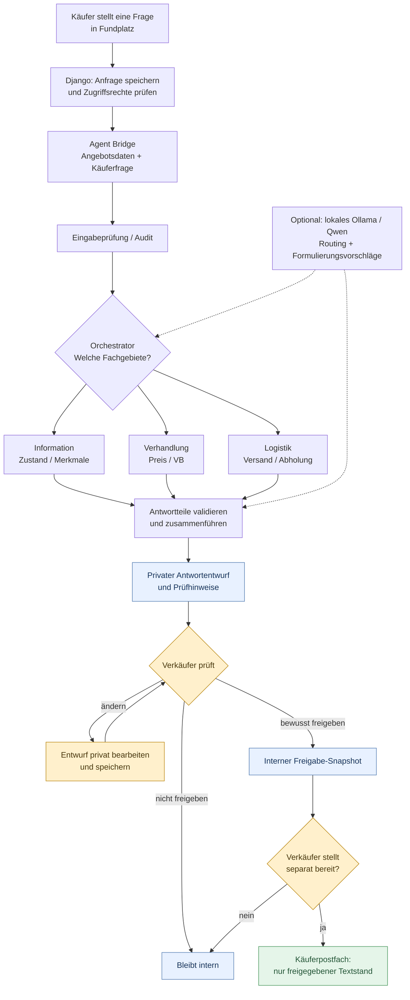
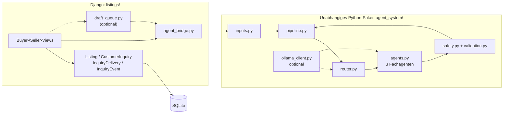
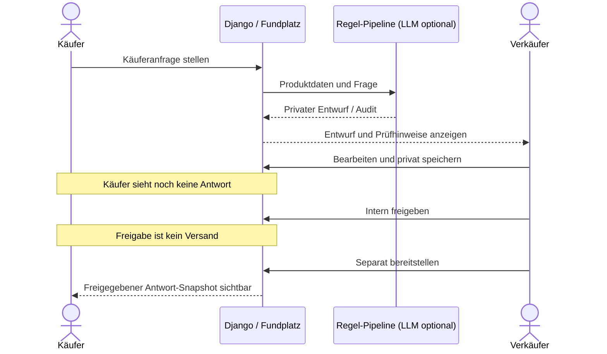

# Fundplatz – Agentenarchitektur und Human-in-the-Loop

[← Projektübersicht](README.md) · [Ist-/Soll-Situation](docs/ist-soll-situation.md) · [Technische Architektur](docs/architecture.md) · [Tests](docs/testing.md)

> **Projektstatus:** Implementierter lokaler Django-Prototyp. Die Diagramme beschreiben die bestehende Architektur vereinfacht. Es gibt **keine Integration oder automatische Nachrichtenübermittlung zu Kleinanzeigen, Shopify oder MediaMarkt**.

## Ausgangsproblem und Idee

Eine Anzeige wird für **100 €** angeboten. Die nächste Nachricht lautet: „20 € akzeptabel?“ Kurz danach: „Für 40 € hole ich sofort ab.“ Wiederkehrende Preis- und Abholfragen kosten Aufmerksamkeit; einige bleiben deshalb unbeantwortet. Fundplatz bereitet für solche Fälle einen überprüfbaren Entwurf vor, damit Verkäufer nicht jede Antwort vollständig neu schreiben müssen. **Ob eine Antwort angemessen ist und ob ein Preisangebot angenommen wird, entscheidet immer der Mensch.**

Das konkrete hypothetische Beispiel und seine Ist-/Soll-Betrachtung stehen in [`docs/ist-soll-situation.md`](docs/ist-soll-situation.md).

## 1. Die gesamte Verarbeitung auf einen Blick

**Wichtig:** Die gestrichelten Modellverbindungen sind **optional**. Der Standardbetrieb funktioniert regelbasiert. Modellformulierungen ersetzen nicht die deterministische Basis und werden nicht ungeprüft veröffentlicht.

## 2. Module und Systemgrenzen

Die Agenten enthalten keine Django-Imports; die [`agent_bridge.py`](listings/agent_bridge.py) übergibt einen strukturierten Produktkontext und die Käuferfrage. Die echte Speicherung und Veröffentlichung wird vom Django-Teil gesteuert.

## 3. Drei Agenten, unterschiedliche Zuständigkeiten

| Agent | Aufgabe | Besondere Grenze |
| --- | --- | --- |
| [Information-Agent](agent_system/agents.py) | Angebotsmerkmale, Zustand, Details und bekannte Preise aus hinterlegten Daten | Eine aktive Anzeige ist keine bestätigte Verfügbarkeit. |
| [Negotiation-Agent](agent_system/agents.py) | Preisfragen und Hinweis auf Verhandlungsbasis (VB) bzw. Festpreis | Keine automatische Annahme, kein erfundener Rabatt, **keine freien LLM-Verhandlungsformulierungen**. |
| [Logistics-Agent](agent_system/agents.py) | Vorhandene Angaben zu Versand, Abholung und Ort | Keine erfundenen Versandkosten, Lieferzeiten oder verbindlichen Termine. |

**Mehrfachrouting:** „Würdest du 40 € akzeptieren und kann ich heute abholen?“ kann Preisverhandlung **und** Logistik betreffen. Ein einzelner Agent muss also nicht alles beantworten.

## 4. Menschliche Kontrolle als Zustandsfolge

Die Umsetzung trennt in [`models.py`](listings/models.py) **`private_draft`**, **`seller_draft`**, **`approved_response`** und **`InquiryDelivery.response_text`**. Ein interner Entwurf kann daher nicht ohne die ausdrücklichen Schritte des Verkäufers im Käuferpostfach erscheinen. Dies ist **Human-in-the-Loop**, nicht vollautonome KI-Kommunikation.

## 5. Beispiel: Niedriges Angebot mit Abholdruck

*Hypothetisch, nicht als exakter vom aktuellen Code generierter Wortlaut zu verstehen.*

**Anzeige:** Fahrrad, 100 €, Verhandlungsbasis aktiviert, Abholung möglich.  
**Anfrage:** „Wenn du 40 machst, komme ich sofort abholen.“

- Der **Verhandlungs-Agent** betrachtet Angebotspreis und die Einstellung „VB“.
- Der **Logistik-Agent** kann bestätigen, dass laut Anzeige Abholung angeboten wird; ein Termin ist damit noch nicht zugesagt.
- Die Pipeline erzeugt einen **privaten, zu prüfenden Entwurf**. Eine mögliche **vom Verkäufer selbst zu wählende Formulierung** wäre: „Danke für dein Angebot. 40 € möchte ich nicht annehmen. Eine Abholung ist grundsätzlich möglich; einen Termin stimmen wir gesondert ab.“
- Ohne Verkäuferhandlung wird **weder ein Preis akzeptiert noch eine Antwort veröffentlicht**.

Bei **Festpreis** sollte die Verkäuferantwort stattdessen auf den ausgeschriebenen Preis hinweisen. Die Software handelt **nicht** eigenmächtig einen Gegenpreis aus.

## 6. Warum lokal und warum ein optionales LLM?

| Eigenschaft | Zweck |
| --- | --- |
| **Ohne Cloud-API nutzbar** | Der Standardbetrieb generiert regelbasierte Entwürfe ohne Modellaufrufe. |
| **Ollama + optional Qwen** | Bei lokaler Installation können Routing und zusätzliche Vorschläge auf demselben Rechner verarbeitet werden. Das im Code eingestellte Modell ist `qwen3:4b-instruct`. |
| **Keine Pflicht zu API-Gebühren** | Keine kostenpflichtige externe LLM-API erforderlich. Lokale Rechenleistung, Strom und gegebenenfalls Hardware verursachen dennoch Kosten. |
| **Lokale Datenhaltung im Prototyp** | Django speichert im lokalen SQLite- und Medienverzeichnis. Das ist keine pauschale Datenschutzgarantie; Rechner, Backups, Logs und optionale Integrationen müssen separat abgesichert werden. |
| **Kontrolle und Reproduzierbarkeit** | Regeln und Tests sind ohne externen Modellservice ausführbar; Modellvorschläge sind von der verbindlichen Verkäuferantwort getrennt. |

Ein „kostenloses LLM“ bedeutet nicht, dass jede Modellversion oder Nutzungsform ohne Lizenzbedingungen ist; für neue Modelle die jeweils geltenden Lizenzen prüfen.

## 7. Plattformregeln und Integrationsgrenze

Fundplatz wurde **von wiederkehrenden Anfragen auf Kleinanzeigen-ähnlichen Marktplätzen inspiriert**, ist aber keine offizielle Kleinanzeigen-Anwendung. Die aktuelle Django-Website enthält **keinen Scraper, keinen Kleinanzeigen-API-Client und keinen automatischen Versand an Kleinanzeigen**.

Die [Kleinanzeigen-Nutzungsbedingungen](https://themen.kleinanzeigen.de/nutzungsbedingungen/) untersagen in § 5 unter anderem automatisierte Mechanismen zum Zugriff und Sammeln von Inhalten ohne ausdrückliche schriftliche Zustimmung. Deshalb wird hier keine Zulässigkeit einer Browser-Erweiterung, Scraping-Lösung oder externen Nachrichtenautomatisierung behauptet. Vor einer solchen Erweiterung wären ausdrückliche Erlaubnis beziehungsweise eine geeignete autorisierte Schnittstelle und eine erneute rechtliche Prüfung erforderlich. **Human-in-the-Loop allein macht ein anderes technisches Verfahren nicht automatisch AGB-konform.**

## 8. Relevante technische Nachweise

- [`agent_system/pipeline.py`](agent_system/pipeline.py) – Routing, Agentenausführung und Prüfungen
- [`agent_system/agents.py`](agent_system/agents.py) – Information, Verhandlung und Logistik
- [`agent_system/router.py`](agent_system/router.py) – Orchestrator / Routing
- [`agent_system/validation.py`](agent_system/validation.py) – Antwortprüfung
- [`agent_system/ollama_client.py`](agent_system/ollama_client.py) – optional lokales Modell
- [`listings/agent_bridge.py`](listings/agent_bridge.py) – Integration mit Django
- [`listings/models.py`](listings/models.py) – getrennte Zustände und Snapshots
- [Tests und Grenzen](docs/testing.md) · [Historische Evaluationen](docs/evaluation/README.md)
