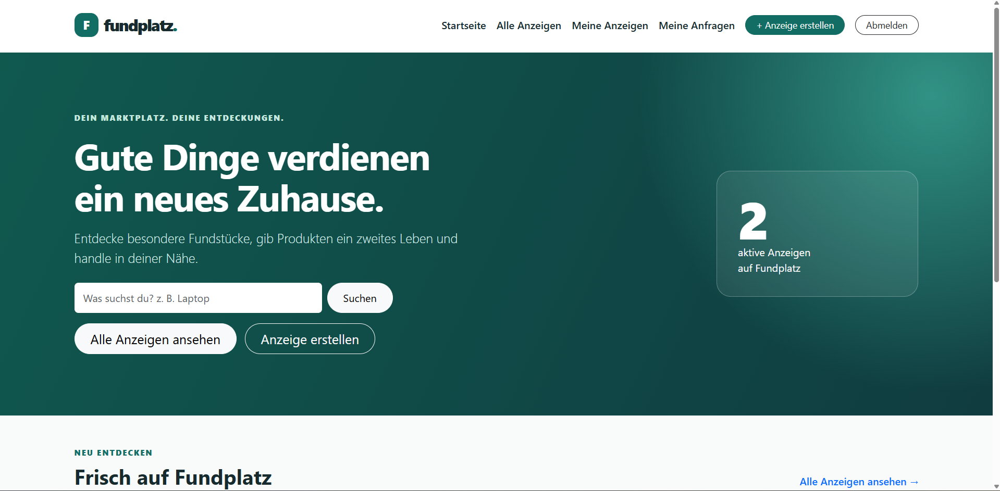
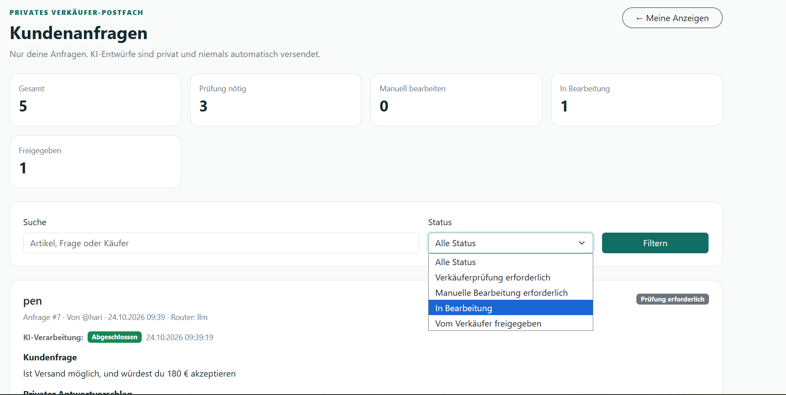
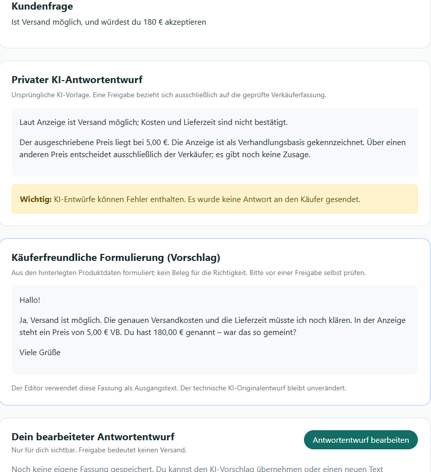
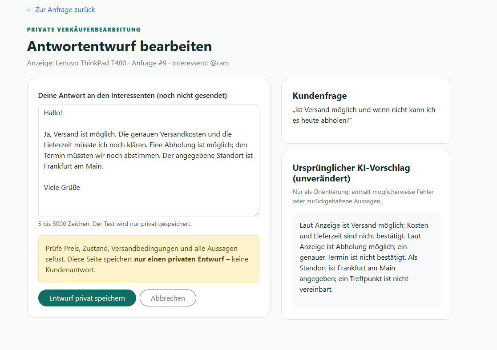
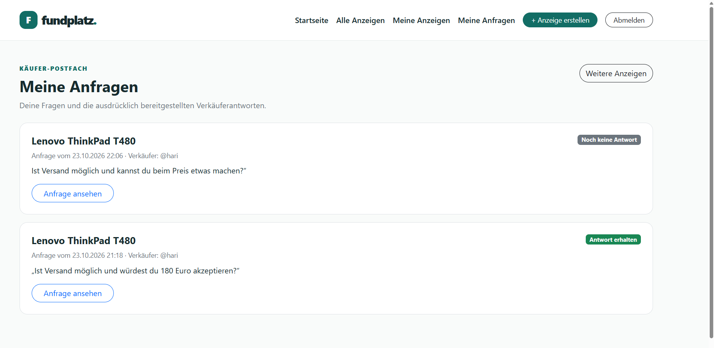
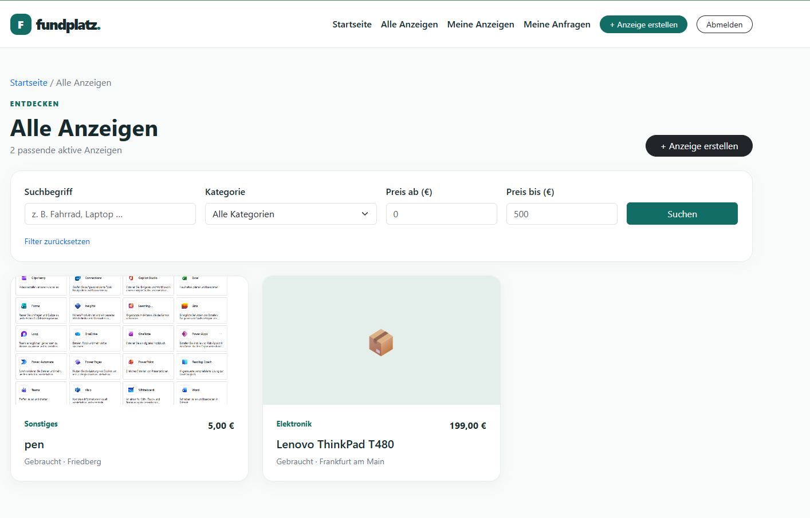
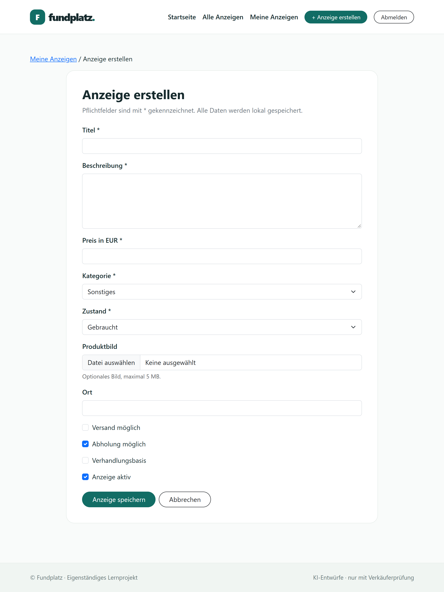
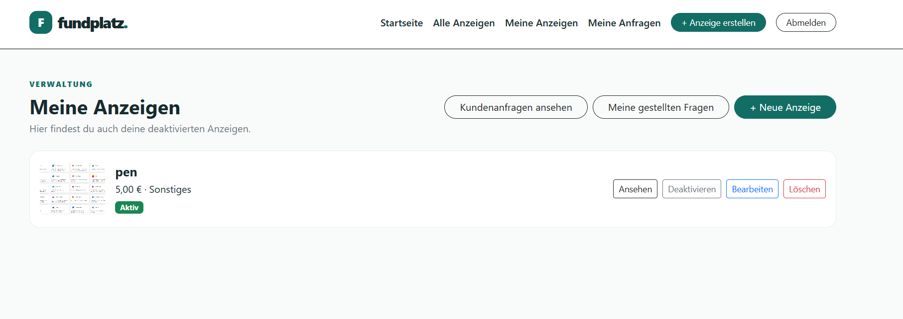
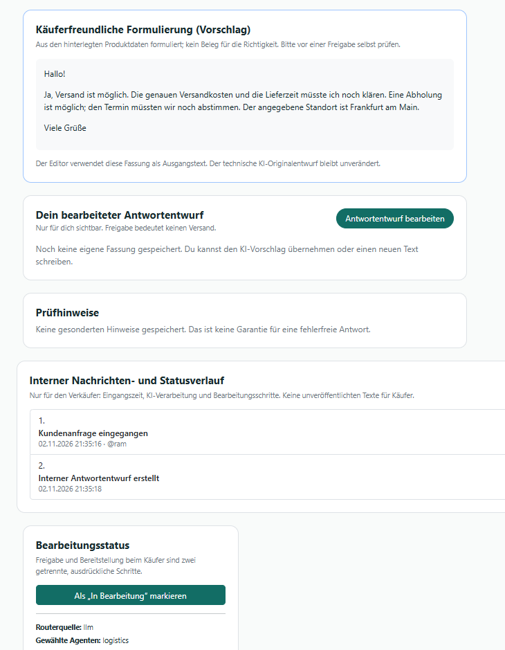

# Fundplatz

**Lokaler Django-Marktplatz mit drei spezialisierten Agenten für Käuferanfragen.** Käufer stellen Fragen zu Anzeigen; Fundplatz erstellt einen *privaten* Antwortentwurf. Verkäufer prüfen und bearbeiten den Text, geben ihn intern frei und stellen ihn anschließend separat im Käuferpostfach bereit. **Keine automatische Veröffentlichung und kein externer Nachrichtenversand.**

**Über das Projekt:** Persönliches Lernprojekt von Nabin Adhikari (Wirtschaftsinformatik, THM); entwickelt zur Vertiefung von Python, Django, KI-Integration und Softwaretests im Hinblick auf ein Pflichtpraktikum.

## Technische Highlights

| Schwerpunkt | Nachweis im Code |
| --- | --- |
| **Webentwicklung** | Django-Anzeigen, Suche, Eigentümerrechte und Postfächer in [`listings/`](listings/) |
| **Multi-Agenten-System** | [Orchestrator und Pipeline](agent_system/pipeline.py), [Information-/Preis-/Logistik-Agenten](agent_system/agents.py) |
| **Lokales KI-Modell** | [Ollama-Client](agent_system/ollama_client.py) mit optionalem Qwen; ohne Ollama regelbasierter Betrieb |
| **Menschliche Freigabe** | [Datenmodelle](listings/models.py) trennen private Entwürfe, intern freigegebene Texte und bereitgestellte Antwort-Snapshots |
| **Hintergrundverarbeitung** | Optionale [DB-Queue](listings/draft_queue.py) mit separatem Management-Worker |
| **Testbarkeit** | [Django-Tests](listings/) und [Agententests](agent_system/tests/); historisch dokumentiert: 430 + 281 erfolgreiche Tests am 27.10.2026, nicht von GitHub-CI bestätigt |

**In zwei Minuten:** [Bilder und Funktionen](#die-anwendung-in-bildern) · [Architektur](docs/architecture.md) · [Tests](docs/testing.md) · [Evaluationsberichte](docs/evaluation/README.md) · [lokaler Start](#lokal-starten)

## Die Anwendung in Bildern

Die Aufnahmen stammen vom lokalen Entwicklungsserver und zeigen **verschiedene Zustände und teils unterschiedliche Beispielanfragen**. Sie sind kein Nachweis für eine abgeschlossene manuelle oder produktive Systemabnahme.

### 1. Startseite – Einstieg in den Marktplatz



Die Startseite erklärt den Marktplatz, bietet eine direkte Produktsuche und führt zur Anzeigenübersicht oder zum Formular für neue Anzeigen. Eine Kennzahl zeigt die derzeit aktiven Inserate.

### 2. Verkäuferpostfach – eingegangene Fragen verwalten



Im privaten Verkäuferpostfach sieht der Anzeigeninhaber seine Kundenfragen, den Verarbeitungsstatus und die erforderlichen nächsten Schritte. Eine Suche und ein Statusfilter helfen bei mehreren Anfragen. **KI-Entwürfe sind nicht automatisch an Käufer versendet.**

### 3. Antwortentwurf – Regelbasis und freundlicher Formulierungsvorschlag



Die Detailansicht zeigt getrennt den ursprünglichen regelbasierten Entwurf und eine käuferfreundlichere Formulierung. Warnungen machen sichtbar, dass Fakten und Preiszusagen vor jeder Freigabe vom Verkäufer geprüft werden müssen. Die abgebildete Testanfrage enthält einen ungewöhnlichen Preisvergleich; der Screenshot belegt keine inhaltliche Korrektheit des Vorschlags.

### 4. Antworteditor – Verkäufer behält die Kontrolle



Der Verkäufer kann den Text selbst formulieren oder ändern und **nur privat speichern**. Rechts bleiben Käuferfrage und ursprünglicher Vorschlag zum Abgleich sichtbar; das Speichern ist ausdrücklich **keine Veröffentlichung**.

### 5. Käuferpostfach – veröffentlichte Antworten



Käufer verfolgen ihre gestellten Fragen und erkennen, ob eine Verkäuferantwort vorliegt. Nur der ausdrücklich bereitgestellte Text erscheint beim Käufer, nicht der interne KI-Entwurf.

<details>
<summary><strong>Vier weitere Screenshots ansehen: Suche, Anzeigenverwaltung und Statusverlauf</strong></summary>

### 6. Anzeigenkatalog – Suche und Filter



Die Katalogseite ermöglicht die Suche nach Produktnamen beziehungsweise Beschreibung und Filter nach Kategorie und Preisbereich. Aktive Anzeigen erscheinen mit Bild, Preis, Kategorie und Ort.

### 7. Anzeige erstellen – Produktkontext erfassen



Das Formular sammelt Titel, Beschreibung, Preis, Kategorie, Zustand und optional ein Bild und den Standort. Versand, Abholung und Verhandlungsbasis sind ausdrücklich einstellbar – diese Angaben fließen später in den Kontext für Antwortentwürfe ein.

### 8. Eigene Anzeigen – Verwaltung und Status



Der Verkäufer verwaltet seine eigenen Inserate, einschließlich deaktivierter Anzeigen. Die Oberfläche bietet Aktionen zum Ansehen, Bearbeiten, Aktivieren beziehungsweise Deaktivieren und Löschen.

### 9. Detailansicht – interner Verlauf und Bearbeitungsstatus



Ein interner Nachrichten- und Statusverlauf zeigt Eingang und Verarbeitung der Anfrage. Der Verkäufer sieht Prüfhinweise, den gewählten Agenten und die weiteren Bearbeitungsschritte. Diese internen Angaben sind vom Käuferpostfach getrennt.

</details>

## Ablauf und Architektur

```text
Käuferfrage → Produktkontext → Routing → Information / Verhandlung / Logistik
            → Validierung → privater Antwortentwurf
            → Verkäufer bearbeitet → interne Freigabe
            → getrennte Bereitstellung im Käuferpostfach
```

Die Anwendung nutzt serverseitig gerenderte Django-Templates, SQLite, lokale Bootstrap-Styles und ein separates Python-Modul `agent_system`. Die Übersetzungsschicht [`listings/agent_bridge.py`](listings/agent_bridge.py) hält die Agentenlogik unabhängig von Django. Optional ist ein getrennter Worker für langlaufende LLM-Aufrufe aktivierbar.

**Wichtig:** Die Basisantworten werden regelbasiert aus den hinterlegten Produktdaten erstellt. Ollama kann Routing und alternative Formulierungen unterstützen; freie Modelltexte werden nicht automatisch zum verbindlichen Verkäufertext. [Technische Architektur und Grenzen](docs/architecture.md).

## Lokal starten

**Voraussetzungen:** Git und Python 3.12. Für den Standardbetrieb ist Ollama **nicht** nötig.

```powershell
git clone https://github.com/NabinAd/Fundplatz.git
cd Fundplatz
python -m venv .venv
.\.venv\Scripts\python.exe -m pip install -r requirements.txt
.\.venv\Scripts\python.exe manage.py migrate
.\.venv\Scripts\python.exe manage.py runserver
```

Anschließend `http://127.0.0.1:8000/` öffnen. Testbenutzer und Anzeigen werden lokal selbst erstellt. Für Linux/macOS statt `.\.venv\Scripts\python.exe` den Pfad `.venv/bin/python` verwenden und die virtuelle Umgebung mit `python3.12 -m venv .venv` anlegen.

**Optional lokales Modell:** Ollama unter `http://127.0.0.1:11434` starten und `ollama pull qwen3:4b-instruct` ausführen. Für die synchrone Modellnutzung `FUNDPLATZ_AGENT_USE_LLM=1` vor dem Webserverstart setzen. Für die optionale Queue zusätzlich `FUNDPLATZ_AGENT_ASYNC=1` im Webserverprozess und `FUNDPLATZ_AGENT_USE_LLM=1` im getrennten Workerprozess setzen; den Worker mit `python manage.py process_inquiries --loop` starten. Unter PowerShell Variablen als `$env:NAME="1"` setzen. Ohne Worker bleiben Jobs in `queued`.

### Ablauf selbst prüfen

1. Verkäufer registrieren, Anzeige erstellen; in zweitem Browserprofil ein Käuferkonto anlegen.
2. Als Käufer eine Frage zur fremden Anzeige stellen.
3. Im Verkäuferpostfach Entwurf und Fakten kontrollieren, gegebenenfalls bearbeiten und privat speichern.
4. Antwort **intern freigeben**; die Käuferansicht darf sie noch nicht zeigen.
5. Anschließend **separat bereitstellen** und im Käuferpostfach prüfen.

## Tests, Qualitätsnachweise und Projektstand

```powershell
$env:FUNDPLATZ_AGENT_USE_LLM="0"
$env:FUNDPLATZ_AGENT_ASYNC="0"
.\.venv\Scripts\python.exe manage.py check
.\.venv\Scripts\python.exe manage.py makemigrations --check --dry-run
.\.venv\Scripts\python.exe manage.py test listings --noinput
.\.venv\Scripts\python.exe -m unittest discover -s agent_system/tests
.\.venv\Scripts\python.exe manage.py fundplatz_audit --strict --json
```

**Dokumentierter älterer Nachweis (27. Oktober 2026, Commit [`274086d`](https://github.com/NabinAd/Fundplatz/commit/274086d598af84f2b49684987ae16ca4f6f5d922)):** Django-Systemprüfung, Migrationen, 430 Django-Tests und 281 Agententests unter Windows/Python 3.12.10 erfolgreich; LLM und Async-Modus waren für diese Testläufe ausgeschaltet. Ein unabhängiger neuer Testlauf wurde im Zuge dieser Dokumentationsüberarbeitung **nicht durchgeführt**. Der manuelle Ende-zu-Ende-Durchlauf mit echtem Qwen war zuletzt nicht vollständig abgenommen.

- [Teststrategie, Testbefehle und offene Abnahme](docs/testing.md)
- [Szenarioauswertung einschließlich Aussagegrenzen](docs/evaluation/README.md)
- [Entwicklungsverlauf und frühere Korrekturen](docs/development-history/README.md)

## Einschränkungen und Sicherheit

Fundplatz ist ein **lokaler Lernprototyp**, kein produktiv abgesicherter Marktplatz. Die vorhandene Konfiguration nutzt `DEBUG=True`, lokale Hosts, einen Entwicklungs-Secret-Key-Fallback und SQLite. Es gibt keinen externen Nachrichtenversand, keine Zahlungsabwicklung und keinen produktiven Echtzeit-Chat. Berechtigungstests und einfache Validierungsregeln ersetzen weder Penetrationstests noch eine vollständige DSGVO-Prüfung. Vor einem öffentlichen Deployment wären unter anderem Secrets, HTTPS, Härtung, Backup, Monitoring und Lasttests erforderlich. Bei fehlenden Produktdaten oder LLM-Ausfall muss der Verkäufer selbst prüfen.

## Repository-Orientierung

- [`listings/`](listings/) – Django-Modelle, Formulare, Views, Berechtigungen und Tests
- [`agent_system/`](agent_system/) – Eingaben, Orchestrator, drei Agenten, Validierung, Ollama und Agententests
- [`config/`](config/) – Django-Einstellungen und URL-Konfiguration
- [`static/`](static/) und [`templates/`](templates/) – Darstellung, Bootstrap, HTML und JavaScript
- [`scripts/`](scripts/) – lokales Abnahmeskript
- [`docs/`](docs/) – Architektur, Testdokumentation, Screenshots, historische Evaluationen und zusammengefasste Entwicklungsschritte

