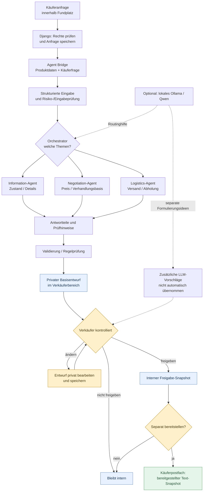
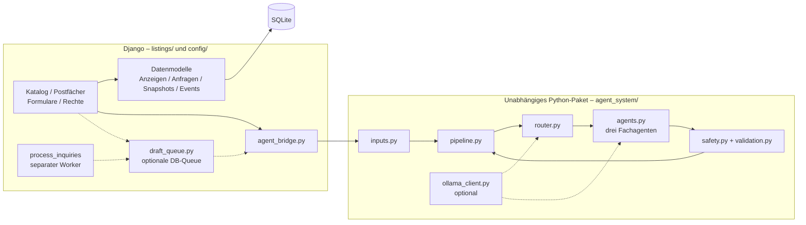
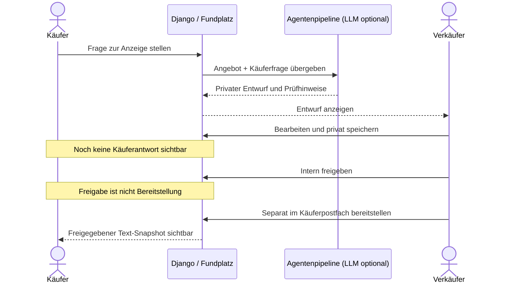
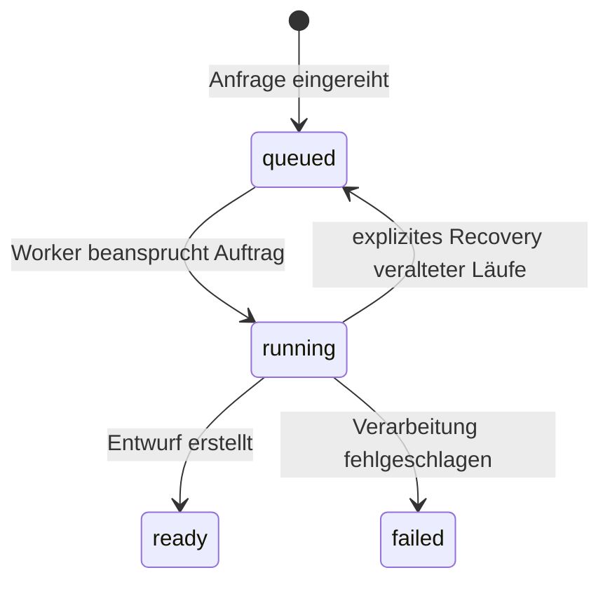

# Fundplatz – System- und Agentenarchitektur

[← Projektübersicht](README.md) · [Ist-/Soll-Situation](docs/ist-soll-situation.md) · [Tests und Abnahme](docs/testing.md) · [Evaluation](docs/evaluation/README.md)

> **Stand:** Fundplatz ist ein **lokaler Django-Lernprototyp**, kein produktiver Marktplatz und keine offizielle Kleinanzeigen-Integration. Die Diagramme veranschaulichen die implementierten Komponenten und ihre wichtigsten Kontrollpunkte; sie stellen keine produktive Last- oder Sicherheitsfreigabe dar.

## 1. Problem, Ziel und Grundprinzip

Ein Verkäufer bietet einen Artikel für **100 €** an. Ein Interessent fragt „20 € akzeptabel?“, ein anderer schreibt „Wenn du 40 € machst, komme ich sofort abholen.“ Andere Nachrichten wiederholen Fragen zu Zustand, Versand oder Verfügbarkeit. Solche Anfragen müssen nicht unseriös sein, aber ihre Bearbeitung kann sich wiederholen.

**Fundplatz soll eine schnelle, kontrollierte Antwortvorbereitung ermöglichen:** Die Software erkennt die behandelten Themen, verwendet verfügbare Anzeigenangaben und erzeugt einen **privaten** Antwortentwurf. Der Verkäufer prüft die Inhalte, bearbeitet den Text und entscheidet selbst über Freigabe und separate Bereitstellung im Käuferpostfach. **Keine autonome Preisannahme, kein automatischer Nachrichtenversand.** Ausführliche hypothetische Beispiele stehen in der [Ist-/Soll-Analyse](docs/ist-soll-situation.md).

## 2. Gesamtfluss – von der Käuferfrage zur bereitgestellten Antwort

**Wichtig:** Die Verarbeitung kann mehrere Fachagenten auswählen. Der Standardbetrieb läuft **ohne LLM** und erstellt regelbasierte Entwürfe. Die optionale lokale Modellnutzung ist keine automatische Freigabe und darf keine verbindlichen Preis- oder Terminzusagen treffen.

## 3. Komponenten und Modulgrenzen

| Komponente | Verantwortlichkeit | Implementierung |
| --- | --- | --- |
| **Django-Konfiguration** | Einstellungen, zentrale URL-Konfiguration, Session-/Formularschutz, Datenbank | [`config/`](config/) |
| **Marktplatz** | Nutzerkonten, Inserate, Suche/Filter, Käufer- und Verkäuferansichten, Eigentümerprüfungen | [`listings/`](listings/), [`views.py`](listings/views.py) |
| **Persistenz** | Anzeigen, Anfragen, Entwürfe, Freigaben, bereitgestellte Antworten und Verlauf | [`models.py`](listings/models.py) |
| **Agent Bridge** | Übersetzt eine Django-Anzeige samt Käuferfrage in Agenteneingaben; keine automatische Veröffentlichung | [`agent_bridge.py`](listings/agent_bridge.py) |
| **Agentenpipeline** | Routing, Agentenaufrufe, Prüfungen, Zusammenführung, Fehlerbehandlung | [`agent_system/pipeline.py`](agent_system/pipeline.py) |
| **Optionales LLM** | Lokale Modellanfragen mit Ollama, optionales Qwen-Routing und zusätzliche Formulierungsvorschläge | [`ollama_client.py`](agent_system/ollama_client.py) |
| **Optionale Hintergrundverarbeitung** | Datenbankwarteschlange und separater Management-Worker | [`draft_queue.py`](listings/draft_queue.py), [`process_inquiries.py`](listings/management/commands/process_inquiries.py) |
| **Benutzeroberfläche** | Serverseitige Django-Templates, lokales Bootstrap/CSS und JavaScript zur Statusaktualisierung | [`templates/`](templates/), [`static/`](static/) |

Der Kern des Agentensystems enthält **keine Django-Imports**. Die Brücke macht die Abhängigkeit explizit und ermöglicht separate Agenten-Unittests. SQLite speichert im lokalen Prototyp die Anwendungsdaten; Bild-Uploads liegen im lokalen `media/`-Verzeichnis.

## 4. Die drei Spezialagenten

| Agent | Bearbeitet | Grenzen |
| --- | --- | --- |
| **Information-Agent** | Zustand, Eigenschaften, Beschreibung, bekannte Angebotsdaten, Verfügbarkeit, wenn tatsächlich bestätigt | Keine erfundenen Produkteigenschaften. `is_active=True` beweist nicht, dass eine Ware verfügbar ist. |
| **Negotiation-Agent** | Angebotspreis, Preisfragen und Status „Verhandlungsbasis“ (VB) | Kein autonomes Gegenangebot oder Abschluss, keine freie LLM-Verhandlungsantwort. |
| **Logistics-Agent** | Versand, Abholung, Ort und vorhandene Logistikangaben | Keine erfundenen Versandkosten, Termine, Lieferfristen oder Treffpunkte. |

Der [Orchestrator](agent_system/router.py) ordnet eine Käuferfrage einem oder mehreren dieser Bereiche zu. Beispielsweise betrifft „Würdest du 40 € akzeptieren und kann ich heute abholen?“ **Verhandlung und Logistik**. Eingaben und Ergebnisse werden durch [`inputs.py`](agent_system/inputs.py), [`safety.py`](agent_system/safety.py) und [`validation.py`](agent_system/validation.py) begrenzt bzw. geprüft.

## 5. Regelbasierte Verarbeitung und optionales lokales LLM

| Modus | Verhalten |
| --- | --- |
| **Standard – `FUNDPLATZ_AGENT_USE_LLM=0`** | Regelbasiertes Routing und deterministische Basisformulierungen aus gespeicherten Angebotsinformationen. Läuft ohne Ollama. |
| **Optional – `FUNDPLATZ_AGENT_USE_LLM=1`** | Ollama kann Routing unterstützen und bei geeigneten Agenten weitere Formulierungsvorschläge liefern. Diese werden **nicht ungeprüft** als veröffentlichter Text übernommen; der Verhandlungsagent lässt keine freien LLM-Formulierungen zu. |
| **Fehler-/Konfliktfall** | Gekennzeichneter Regel-Fallback, Rückfrage oder manuelle Bearbeitung; **keine automatische Käuferantwort**. |

Als lokales Modell ist im Code `qwen3:4b-instruct` voreingestellt. Das Projekt erfordert **keine kostenpflichtige Cloud-LLM-API**. Eine lokale Nutzung kann Datenübertragungen an externe KI-Dienste vermeiden, ist jedoch **keine pauschale Datenschutzgarantie**: Arbeitsplatzrechner, Logs, Backups, Modelllizenzen und eventuelle spätere Schnittstellen müssen berücksichtigt werden. Hardware- und Stromkosten bleiben bestehen.

## 6. Human-in-the-Loop und Datenzustände

Die [Datenmodelle](listings/models.py) trennen die fachlichen Zustände:

| Modell / Feld | Bedeutung |
| --- | --- |
| `Listing` | Anzeige mit Verkäufer, Preis, VB sowie Versand-/Abholangaben |
| `CustomerInquiry.message` | Käuferfrage zur jeweiligen Anzeige |
| `CustomerInquiry.private_draft` | Ursprünglicher privater Systementwurf |
| `CustomerInquiry.seller_draft` | Bearbeitbare private Verkäuferfassung |
| `CustomerInquiry.approved_response` | Explizit freigegebene **interne** Momentaufnahme; noch nicht veröffentlicht |
| `InquiryDelivery.response_text` | Separat bereitgestellter Antwort-Snapshot im Käuferpostfach |
| `InquiryEvent` | Bearbeitungs-/Statusereignisse mit getrennter Käufer-/Verkäufer-Sicht |

Die Django-Views kontrollieren Eigentümerrechte und Sichtbarkeit. Die Trennung von Freigabe und Bereitstellung ist absichtlich: Ein gespeicherter oder freigegebener Entwurf wird **nicht automatisch** beim Käufer sichtbar. Sie ermöglicht ein überprüfbares Vorgehen mit menschlichen Entscheidungspunkten, ersetzt aber keine vollständige Sicherheitsprüfung.

## 7. Optionale Queue und Worker

Bei `FUNDPLATZ_AGENT_ASYNC=0` arbeitet die Anwendung standardmäßig synchron. Bei `FUNDPLATZ_AGENT_ASYNC=1` wird die Entwurfserstellung in eine lokale SQLite-basierte Warteschlange ausgelagert. Ein separat gestarteter Worker verarbeitet die Aufträge.

Die Implementierung verwendet bedingte Datenbank-Updates und eine Versuchszahl, um bestimmte konkurrierende bzw. veraltete Worker-Schreibvorgänge abzufangen. **Ohne Worker** können Aufträge in `queued` verbleiben. Die Queue ist für den lokalen Lernprototyp gedacht, **nicht als hochverfügbare Produktionsinfrastruktur**.

## 8. Beispielablauf: 100-€-Anzeige und 40-€-Anfrage

*Hypothetisches Szenario; die folgende Verkäuferantwort ist kein garantiertes wörtliches Ergebnis der bestehenden Pipeline.*

**Anzeige:** Fahrrad, 100 €, VB aktiviert, Abholung möglich.  
**Frage:** „Wenn du 40 machst, komme ich sofort abholen.“

1. Der Router erkennt relevante Themen: **Verhandlung + Abholung**.
2. Der Verhandlungsagent verwendet Angebotspreis und VB-Information, akzeptiert aber **keine** 40 €.
3. Der Logistikagent darf nur auf die in der Anzeige angegebene Abholmöglichkeit hinweisen; ein konkreter Termin ist damit **nicht** vereinbart.
4. Die Pipeline zeigt einen **privaten** Entwurf und gegebenenfalls Prüfhilfen.
5. Der Verkäufer könnte nach eigener Entscheidung formulieren: „Vielen Dank für dein Angebot. 40 € möchte ich nicht annehmen. Eine Abholung ist grundsätzlich möglich; einen Termin stimmen wir gesondert ab.“
6. Nur der Verkäufer kann diese Fassung bearbeiten, intern freigeben und **separat** im Käuferpostfach bereitstellen.

Bei einem **Festpreis** wäre eine andere Reaktion sinnvoll; auch hier macht das System keine eigenständigen finanziellen Zusagen.

## 9. Plattformbezug und technische Grenzen

Fundplatz wurde von wiederkehrenden Nachrichten auf **Kleinanzeigen-ähnlichen Marktplätzen** inspiriert. Die aktuelle Implementierung verwendet **eigene Django-Anfragen**; sie enthält **keine** offizielle Kleinanzeigen-, Shopify- oder MediaMarkt-Integration, keinen externen Nachrichtenversand und keinen Scraper.

Die [Kleinanzeigen-Nutzungsbedingungen](https://themen.kleinanzeigen.de/nutzungsbedingungen/) setzen Grenzen für automatisierte Zugriffe bzw. das Sammeln von Inhalten ohne die erforderliche Zustimmung. Für eine künftige Anbindung müssten aktuelle AGB, nötige Erlaubnisse, zulässige Schnittstellen und Datenschutz eigenständig geprüft werden. **Human-in-the-Loop macht ein unzulässiges Einleseverfahren nicht automatisch erlaubt.**

Weitere Grenzen des lokalen Prototyps:

- **Keine vollständige Faktenprüfung:** Regel-/Heuristikprüfungen und ein lokales LLM können fehlerhafte oder unvollständige Produktangaben nicht verlässlich korrigieren.
- **Kein Produktionsbetrieb:** Entwicklungs-Secret-Key-Fallback, `DEBUG=True`, lokale Hosts und SQLite; vor öffentlichem Betrieb wären Secrets, HTTPS, Monitoring, Backup-/Restore- und Sicherheitshärtung erforderlich.
- **Kein vollständig abgenommener Browser-/LLM-Betrieb:** Automatisierte Tests ersetzen weder einen realen manuellen Ende-zu-Ende-Test noch Last- oder Penetrationstests.
- **Kein automatischer externer Chat, keine Zahlung, keine Preiszusage.**
- **Lokale Medien:** Beim Löschen einer Anzeige werden gespeicherte Bilddateien laut bisheriger Projektdokumentation nicht automatisch vom Datenträger entfernt.

## 10. Code, Tests und weitere Dokumentation

- [Agentenpipeline](agent_system/pipeline.py) · [Router](agent_system/router.py) · [Spezialagenten](agent_system/agents.py) · [Validierung](agent_system/validation.py)
- [Ollama-Client](agent_system/ollama_client.py) · [Agent Bridge](listings/agent_bridge.py) · [Queue](listings/draft_queue.py)
- [Datenmodelle](listings/models.py) · [Django-Views](listings/views.py) · [Management-Worker](listings/management/commands/process_inquiries.py)
- [Django- und Agententests](docs/testing.md) · [Historische Evaluationen](docs/evaluation/README.md)
- [Ist-/Soll-Situation](docs/ist-soll-situation.md) · [Screenshots in der Haupt-README](README.md#die-anwendung-in-bildern)
