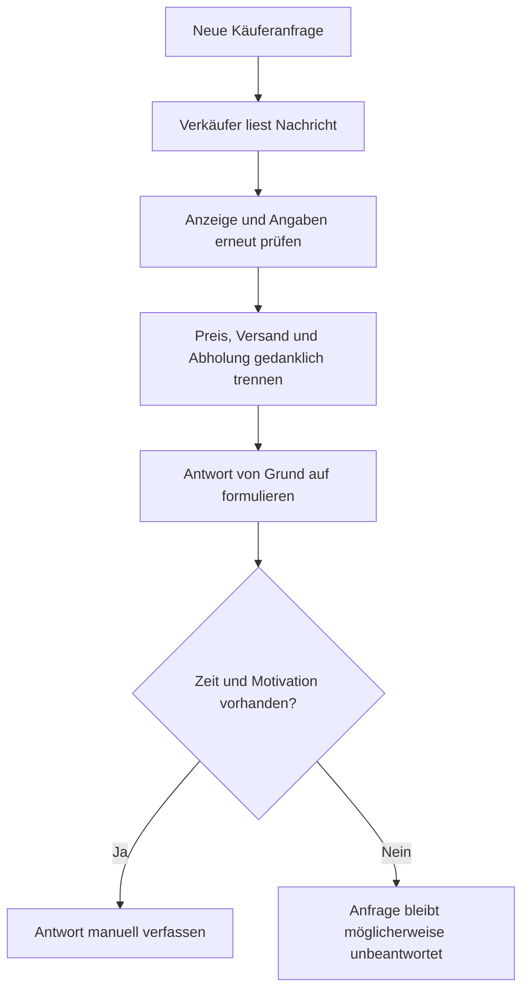
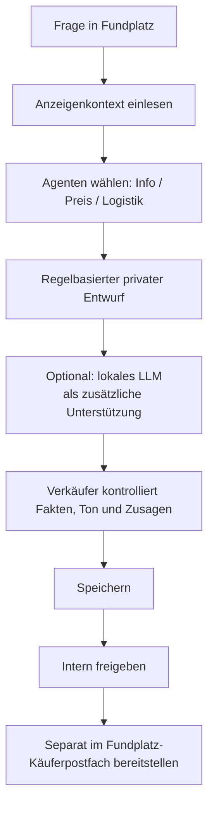

# Ist-/Soll-Situation: Wiederkehrende Käuferanfragen effizient beantworten

[← Projektübersicht](../README.md) · [Agentenarchitektur](../AGENTS.md) · [Technische Architektur](architecture.md)

## 1. Ausgangslage (hypothetisches Szenario)

Ein privater Verkäufer stellt auf einer Online-Kleinanzeigenplattform ein gebrauchtes Fahrrad für **100 €** ein. Eine Person fragt „20 € akzeptabel?“. Eine weitere schreibt „Wenn du 40 € machst, komme ich sofort abholen.“ Andere Interessenten fragen wiederholt nach Versand, Zustand und Verfügbarkeit.

Die Fragen sind nicht automatisch unseriös: Ein niedriger Preisvorschlag kann ein normales Verhandlungsangebot sein. Für den Verkäufer entsteht aber **Wiederholungsarbeit**, weil er immer wieder dieselben Angaben sucht, zwischen Preis und Logistik unterscheiden und eine höfliche Antwort formulieren muss.

Das ist das **Motivationsszenario** für Fundplatz. Es beschreibt **keine echte gemessene Nutzerstudie**, sondern eine plausible Situation, an der sich der Prototyp orientiert.

## 2. IST: Manuelle Kommunikation ohne vorbereiteten Entwurf

**Mögliche Nachteile:** ähnliche Fragen erfordern wiederholte Schreibarbeit, gemischte Anfragen erzeugen zusätzlichen Prüfaufwand und spontane Antworten können unbeabsichtigte Aussagen zu Preis, Versandkosten oder Termin enthalten. Es gibt **keine belastbare Zeitmessung**, wie häufig diese Probleme tatsächlich auftreten.

## 3. SOLL: Kontrollierte Antwortvorbereitung in Fundplatz

**Was heute implementiert ist:** Django-interne Käuferanfragen, Routing zu Fachagenten, private Entwürfe, bearbeitbare Verkäuferfassung, ausdrückliche Freigabe, separate Bereitstellung und optionale lokale Ollama-Anbindung. **Nicht implementiert:** automatisches Einlesen oder Beantworten von Nachrichten auf Kleinanzeigen oder in anderen externen Shops.

### Vergleich

| IST | SOLL mit Fundplatz |
| --- | --- |
| Anzeigeninformationen wiederholt nachlesen | Strukturierter Produktkontext wird für einen Entwurf übergeben |
| Preis und Versand manuell auseinanderhalten | Mehrere passende Fachagenten bearbeiten die Themen |
| Jede Formulierung neu schreiben | Privater Vorschlag dient als Ausgangspunkt |
| Spontane Zusagen möglich | Verkäufer muss ausdrücklich prüfen, bearbeiten und freigeben |
| Wiederholungsaufwand bei ähnlichen Anfragen | Potenziell weniger Schreibarbeit; noch **nicht durch Zeitmessungen belegt** |
| Beim Antworten nur ein einzelner Textstand | Historie und getrennte Entwurf-/Freigabe-/Bereitstellungszustände |

## 4. Vier nachvollziehbare Beispiele

**Alle Antworten unten sind hypothetische, vom Verkäufer zu prüfende Beispiele – keine behaupteten exakten Ausgaben des aktuellen Codes.**

| Anfrage | Zu prüfende Angaben | Mögliche Verkäuferantwort |
| --- | --- | --- |
| „20 €?“ zu 100 € Festpreis | Anzeigenpreis, **kein VB** | „Danke für dein Angebot. Der angegebene Preis beträgt 100 € und ist fest.“ |
| „Wenn du 40 € machst, hole ich sofort ab.“ zu 100 € VB | Angebotspreis, VB, Abholung | „Danke für dein Angebot. 40 € möchte ich nicht annehmen. Abholung wäre möglich; einen Termin müssten wir noch vereinbaren.“ |
| „Ist Versand möglich und wie viel kostet er?“ | Versand verfügbar? Kosten bekannt? | „Laut Anzeige ist Versand möglich. Die genauen Versandkosten muss ich noch prüfen.“ |
| „Noch da? Kann ich heute kommen?“ | Verfügbarkeit und Termin tatsächlich bestätigt? | „Danke für deine Nachricht. Ich prüfe kurz die Verfügbarkeit und melde mich wegen eines möglichen Termins.“ |

**Nicht zulässig als unbeaufsichtigter Systementscheid:** 40 € akzeptieren, einen Treffpunkt oder Versandtermin verbindlich zusagen, Verfügbarkeit aus dem Status „aktiv“ ableiten oder unbelegte Produkteigenschaften behaupten.

## 5. Nutzen und Zielgruppen

**Private Verkäufer:** weniger wiederkehrendes Formulieren und strukturiertere Prüfung. **Häufig inserierende Verkäufer:** bessere Übersicht über mehrere Anfragen und Status. **Größere Händler:** Das Konzept einer geprüften Antwortvorbereitung wäre grundsätzlich auch für Händlerpostfächer denkbar, beispielsweise im Umfeld von Shopify-Shops oder im Kundenservice großer Elektronikhändler wie MediaMarkt. **Das ist ein mögliches Anwendungsszenario, keine bestehende Integration oder Leistungszusage.**

Der mögliche Zeitgewinn müsste anhand realer Nutzeraufgaben gemessen werden, zum Beispiel durch Vergleich der mittleren Bearbeitungszeit je Anfrage, der Korrekturrate, der Quote unbeantworteter Anfragen und der Häufigkeit unbeabsichtigter Zusagen.

## 6. Warum Human-in-the-Loop statt autonomer Chatbot?

Der Mensch übernimmt die **entscheidenden Kontrollpunkte**: Fakten abgleichen, Ton anpassen, Angebot ablehnen oder annehmen, Freigabe auslösen und Antwort separat bereitstellen. Dadurch wird die KI nicht zum selbstständig handelnden Verkäufer. Das kann Fehlerfolgen reduzieren, **garantiert aber keine korrekten Entscheidungen**.

## 7. Lokales und optional kostenloses Modell

Fundplatz funktioniert bereits **ohne externe LLM-API**. Optional lassen sich mit Ollama und lokalem Qwen Routing und Formulierungsvorschläge unterstützen. Der Nutzen: Daten müssen für diesen Verarbeitungsschritt nicht an eine kostenpflichtige Cloud-LLM-API übertragen werden. Hardware, Energie, Modelllizenzen und die Sicherheit der lokalen Datenspeicherung bleiben trotzdem relevant.

## 8. Kleinanzeigen-AGB und rechtliche Abgrenzung

Die aktuelle Anwendung ist eine **eigene lokale Django-Marktplatzumgebung**, nicht Kleinanzeigen. Es findet **keine externe Nachrichtenübermittlung** statt.

Laut [Kleinanzeigen-Nutzungsbedingungen, § 5](https://themen.kleinanzeigen.de/nutzungsbedingungen/) ist die Verwendung automatisierter Zugriffs- und Sammelmechanismen (Crawler, Scraper usw.) ohne ausdrückliche schriftliche Zustimmung untersagt. Eine künftige Browser-Erweiterung oder API-Integration wäre daher **ein eigenständiger Prüf- und Freigabepunkt**. Auch manuell freigegebene Antworten machen ein unzulässiges Einleseverfahren nicht rechtmäßig. Diese Dokumentation behauptet **keine garantierte AGB-Konformität**.

## 9. Umsetzung und Nachweise

Die technische Umsetzung ist in [AGENTS.md](../AGENTS.md) grafisch erklärt; die [Architekturdokumentation](architecture.md) beschreibt die Module und Datenmodelle. [Tests und Abnahme](testing.md) trennen automatisierte Prüfungen vom noch offenen vollständigen manuellen Ende-zu-Ende-Test.

**Kernaussage:** Fundplatz soll die wiederholte Formulierungsarbeit reduzieren, ohne die Entscheidung über Preis, Fakten oder Veröffentlichung an eine autonome KI abzugeben.
